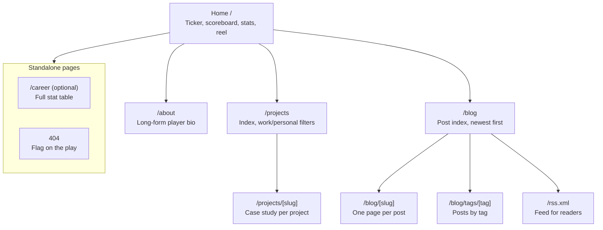
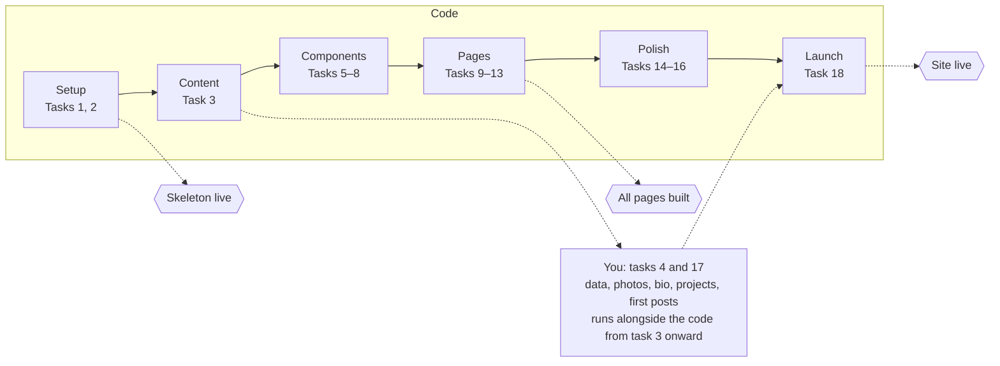

# Portfolio Redesign — Spec

Oct 30, 2026 · @Jimmy

> Living version of this spec: the Portfolio Redesign — Spec doc on Claude. Visual source of truth: the Portfolio Redesign Directions canvas (Game Day artboards).

## Overview

Rebuild liljimmyk99.github.io/about-me as a custom Astro site in the **Game Day** direction (design D on the Portfolio Redesign Directions canvas), replacing the Hugoplate template. The canvas artboards are the visual source of truth; this doc covers structure, content, build and rollout.

**Goals**

- Show the full work history and community roles side by side, not as a flat list
- Put projects (work and personal) up front, each with its own page
- Give a long-form About page and a blog for writing about what you care about
- Make personality visible: Philly and Penn State sports, karate, robotics, faith
- Practice modern web tooling as part of the move toward full-stack

**Audience:** an even mix of hiring managers for full-stack/backend roles and people who know you personally.

**Out of scope for v1:** comments on posts, a CMS, analytics beyond a privacy-friendly page counter, a backend. Each can come later without a rewrite.

## Decisions so far

| Area | Decision | Notes |
| --- | --- | --- |
| Visual direction | Game Day (D) | Sports-broadcast look: scoreboard hero, stat tables, ticker. Philly midnight green + Penn State navy + scoreboard gold. |
| Framework | Astro | Markdown content collections, static output, React/other islands only where interaction is needed |
| Hosting | GitHub Pages | Built and deployed by GitHub Actions on push to `main` |
| URL | liljimmyk99.github.io/about-me for now | Custom domain later; only `site` and `base` in the Astro config change |
| Content source | Markdown/MDX + JSON in the repo | No CMS in v1 |
| Brand assets | No team logos, wordmarks or mascots | Team colors and your own photos only |
| Bio chapter names | Phases, not employers | e.g. "Going pro" instead of "Ford" |
| Branching | `redesign` is the base branch for the refactor | Every sub-task PR targets `redesign`; `redesign` merges into `main` once at launch (task 18) |

## Sitemap



The nav carries four links (Career stats, Highlights, Press box, Bio). Home is the hub; each section index leads to its detail pages. The 404 and the optional `/career` page sit outside the tree.

## Design system

Define every value below once as a CSS custom property in `src/styles/tokens.css`; components never use raw hex values. The site is dark-only in v1, like a broadcast graphic.

**Color tokens**

| Token | Value | Use |
| --- | --- | --- |
| `--bg` | `#0b1a24` | Page background |
| `--surface` | `#10242f` | Cards, list rows, image placeholders |
| `--surface-deep` | `#050c11` | Scoreboard, box score, code blocks |
| `--line` | `#24414d` | Borders, dividers |
| `--line-soft` | `#1a2f3a` | Table and list row rules |
| `--text` | `#f4f6f7` | Primary text |
| `--text-body` | `#dfe5e8` | Long-form body copy |
| `--text-muted` | `#a9b6bd` | Labels, dates, captions |
| `--home` | `#004c54` | Philly midnight green: ticker, footer, primary panels |
| `--away` | `#041e42` | Penn State navy: secondary panels, rules |
| `--gold` | `#ffb81c` | Scoreboard gold: accents, links, primary buttons |

Check every text/background pair at 4.5:1 (3:1 for 24 px+) before launch.

**Type**

| Role | Font | Size / weight |
| --- | --- | --- |
| Display (names, section titles, big numbers) | Bebas Neue | 120 px hero, 64 px section, 32 px card |
| Labels, nav, buttons, tags (uppercase, tracked) | Barlow Condensed | 14–18 px, 600–700, letter-spacing 1–3 px |
| Body | Barlow | 17 px UI, 19 px long-form, line-height 1.6–1.8 |
| Code | JetBrains Mono | 15–16 px |

Self-host the fonts with `@fontsource` packages instead of Google Fonts links.

**Spacing and layout:** 8 px base step; content max-width 1180 px with 24 px gutters; long-form column max 720 px; touch targets at least 44 px; square corners except the scoreboard (6 px).

**Components**

- `Ticker` (Final / In progress / Up next)
- `SiteNav` and `SiteFooter`
- `SectionHeader` (gold eyebrow + Bebas title)
- `Scoreboard` (home/away header, 2×2 stat tiles)
- `StatTable` (career/community rows, optional expand-in-place)
- `ProjectCard` (screenshot, kind/stack strip, name, one-liner)
- `PostRow` and `PostCard` (prev/next)
- `BoxScore` (sidebar key/value panel, reused on posts, projects and bio)
- `PullQuote` (home/away top and bottom rules)
- `CodeBlock` (filename + language header)
- `Button` (gold solid, outline)
- `Tag` / `Chip`

## Page specs

Every page shares the nav, footer and design tokens. Each must work from 360 px phone width up, with no horizontal page scroll.

### Home `/`

1. **Ticker:** two to four items (Final / In progress / Up next), each a link. Built from the newest post plus `src/data/now.json`.
2. **Hero:** eyebrow role line, name, one-line intro, two buttons (stat sheet, LinkedIn).
3. **Scoreboard:** Home · Philly / Away · State College header, four stat tiles from `src/data/scoreboard.json` (black belt degree, ETFCG members led, robotics events volunteered, seasons at the Linc), location footer.
4. **Career stats:** a table of career and community roles tagged by league, newest first. Rows expand in place for two or three bullets; an optional "Read more" link goes to a related page.
5. **Highlight reel:** four featured project cards, each linking to its project page.
6. **Off the field + Fan section:** "Other uniforms" list; Philadelphia and Penn State cards (teams, best moment); one photo.
7. **Press box:** three newest posts, linking to each post and to `/blog`.
8. **Player bio teaser:** two or three sentences, "Full bio" link to `/about`.

### Bio `/about`

Portrait, name, scouting summary and a vitals grid; a chapter bar that jumps to each part; long-form story in quarters (Origin story, College & co-ops, Going pro, Going full-stack, Overtime: Off the clock); a photo with caption and a pull quote; Intangibles and Trophy case sidebar; "Now signing" call to action (LinkedIn, résumé PDF).

### Projects `/projects` and `/projects/[slug]`

- **Index:** all projects as cards, filterable by Work / Personal and by layer (mobile, backend, web, full-stack).
- **Project page:** tags; name and one-liner; buttons for repo, live site or App Store, shown only when the link exists; spec sheet (type, role, platform, started, status); one or two screenshots; sections The pregame (why), The playbook (features), My role, Film review (lessons); stack tags; related posts; previous/next project.
- **Work projects** (e.g. Ford Credit) use the same template with no repo button and only details you are allowed to share.

### Blog `/blog`, `/blog/[slug]`, `/blog/tags/[tag]`

- **Index:** all posts newest first with date, title, tag; tag filter pages.
- **Post:** category eyebrow, title, dek, byline (date, read time), cover image, 720 px reading column (drop cap, headings, inline code, captioned code blocks, pull quotes, images), Box score sidebar (read time, category, stack, related project, "In this post" links), previous/next post, back link.
- **RSS** at `/rss.xml`.

### Career `/career` (optional)

The full stat table on its own page, if the home table needs to stay short. Decide during build.

### 404

A "Flag on the play" page with a link home and to the blog.

## Content model

All content lives in Astro content collections under `src/content/`, validated by Zod schemas in `src/content.config.ts`. Adding a post or project means adding one file; no page code changes.

| Collection | Format | Key fields |
| --- | --- | --- |
| `posts` | MDX, one file per post | `title`, `dek`, `date`, `updated?`, `category`, `tags[]`, `cover?`, `stack[]?`, `relatedProject?` (reference to `projects`), `draft` |
| `projects` | MDX, one file per project | `name`, `oneLiner`, `kind` (work / personal), `layer` (mobile / backend / web / full-stack), `platform`, `role`, `started`, `status`, `stack[]`, `repo?`, `live?`, `appStore?`, `screenshots[]`, `featured`, `order` |
| `roles` | JSON or YAML list | `start`, `end?`, `org`, `title`, `league` (career / community), `bullets[]`, `link?` |
| `trophies` | JSON list | `year`, `title`, `org?` |
| `now` | single JSON file | ticker items: `status` (final / in-progress / up-next), `text`, `href` |
| `scoreboard` | single JSON file | four tiles: `value`, `label` |
| `site` | single JSON file | name, socials (GitHub, LinkedIn, Instagram), location, résumé path, fan-section teams and moments |

**Derived values (computed at build, never typed):** read time from post word count; "seasons at the Linc" from a start year; post and project ordering; tag lists; the ticker's newest-post item.

**Images** go in `src/assets/` and render through Astro's `<Image>` for automatic resizing, WebP/AVIF and width/height attributes.

## Technical architecture

A fully static Astro site: Markdown and JSON in, HTML/CSS out, deployed to GitHub Pages by a GitHub Action. No server, no database, near-zero JavaScript by default.

**Repo layout**

```
src/
  components/   Ticker, Scoreboard, StatTable, ProjectCard, BoxScore, ...
  layouts/      BaseLayout, PostLayout, ProjectLayout
  pages/        index, about, projects/, blog/, rss.xml.ts, 404
  content/      posts/, projects/
  data/         roles, trophies, now, scoreboard, site
  styles/       tokens.css, global.css
  assets/       images
```

**Build and deploy**

- Astro (latest stable) with TypeScript strict mode
- `astro.config.mjs`: `site: 'https://liljimmyk99.github.io'`, `base: '/about-me'` (custom domain later: set `site` to the domain, drop `base`, add a `CNAME`)
- GitHub Actions: the official `withastro/action` builds on push to `main` and deploys to Pages
- Preview: run `npm run dev` locally; optionally deploy pull-request previews to Netlify or Cloudflare Pages

**Interactivity (islands, kept small)**

- Career stats expand-in-place: native `<details>`/`<summary>` (no JS needed)
- Project filters: a small vanilla-JS or Preact island
- Everything else is static

**Integrations:** `@astrojs/mdx`, `@astrojs/rss`, `@astrojs/sitemap`, Shiki syntax highlighting (built in), `@fontsource/*` fonts.

**SEO and sharing:** a per-page title and description; Open Graph/Twitter cards; one default OG image plus per-post covers; canonical URLs; `sitemap-index.xml`; JSON-LD `Person` on home, `BlogPosting` on posts.

**Accessibility:** semantic landmarks, one `h1` per page, visible focus states, skip link, alt text required by the image schema, 4.5:1 contrast, works with the keyboard alone, `prefers-reduced-motion` respected.

**Performance targets:** Lighthouse 95+ on all four categories for mobile; under 100 KB of JavaScript on any page; images lazy-loaded below the fold.

**Quality checks in CI:** `astro check` (types and schemas), a link checker, and Lighthouse CI on home and one post.

## Content migration

Build the new site on the `redesign` branch of this repo, then merge it into `main` in one step; the current Hugo site stays live until launch day.

| From the current site | Goes to | Action |
| --- | --- | --- |
| Home intro (iOS Developer & TPM, ETFCG) | Hero, bio "Going pro" | Rewrite in the new voice |
| "What am I up to?" list (8 roles) | `roles` data → Career stats | Add start/end years, org, league, 2–3 bullets each |
| Technical Experience list | Project stack tags, bio | Fold into projects; no standalone skills list |
| Non-Technical Skills | Bio Intangibles sidebar | Already drafted on the canvas; tighten copy |
| Photos (Eagles field, karate, Bensalem award) | Home fan section, bio, Other uniforms | Copy originals into `src/assets/`, write alt text |
| `/resume` page | Résumé PDF linked from bio and nav | Export a current PDF |
| `/blog` posts (if any) | `posts` collection | Convert front matter; keep slugs or add redirects |
| Social links | `site.json` | GitHub, LinkedIn, Instagram |

**Copy fixes to carry over:** concierge, sensei, languages, "a part of", advice, and the café name at Calvary Chapel.

## Implementation plan

Build it in **18 sub-tasks across 6 phases**, one GitHub issue each, small enough for one pull request (or one agent run) apiece. Ship a vertical slice early: a deployed skeleton after task 2, then a real home page before the long tail of pages and polish.



**Recommended approach**

- **Deploy on day one.** Task 1 ends with an empty Astro page live on GitHub Pages under `/about-me`, so every later PR is visible immediately.
- **Schemas before pages.** Lock the content collections (task 3) early; every component reads typed data, never hard-coded copy.
- **Writing runs in parallel.** Tasks 4 and 17 are yours, not code; start drafting the bio and the first posts while components are built.
- **One page per PR**, each checked at phone and desktop width against its canvas artboard.
- **Launch with at least:** home, bio, four project pages, two posts, RSS, 404. More posts can follow.

**Branching:** every sub-task branches off `redesign` and opens its PR against `redesign`. `redesign` merges into `main` once, at launch (task 18), which swaps the live site from Hugo to Astro in one step.

| # | Phase | Sub-task | Depends on | Size | Owner |
| --- | --- | --- | --- | --- | --- |
| 1 | Setup | Scaffold Astro + TypeScript; GitHub Action deploys to Pages at `/about-me` | none | S | Code |
| 2 | Setup | Tokens, self-hosted fonts, global styles, `BaseLayout` with nav and footer | 1 | M | Code |
| 3 | Content | Content collections + Zod schemas + one sample entry each | 1 | M | Code |
| 4 | Content | Fill `roles`, `trophies`, `site`, `scoreboard`, `now`; copy photos and write alt text | 3 | M | You |
| 5 | Components | Shared parts: SectionHeader, Button, Tag, BoxScore, PullQuote, code block styling | 2 | M | Code |
| 6 | Components | Ticker and Scoreboard | 3, 5 | S | Code |
| 7 | Components | StatTable with expand-in-place rows | 3, 5 | M | Code |
| 8 | Components | ProjectCard, PostRow, prev/next PostCard | 5 | S | Code |
| 9 | Pages | Home page assembled from data | 6, 7, 8 | M | Code |
| 10 | Pages | Bio page with chapter bar, Intangibles, Trophy case | 4, 5 | M | Code |
| 11 | Pages | Projects index with filters + project page template | 8 | L | Code |
| 12 | Pages | Blog index, post layout, tag pages, read time | 8 | L | Code |
| 13 | Pages | RSS feed, sitemap, 404 page | 12 | S | Code |
| 14 | Polish | SEO meta, Open Graph images, JSON-LD | 9–12 | M | Code |
| 15 | Polish | Responsive and accessibility pass (keyboard, contrast, screen reader) | 9–13 | M | Code |
| 16 | Polish | CI checks: `astro check`, link checker, Lighthouse CI | 1 | M | Code |
| 17 | Launch | Write bio chapters, four project pages, first two posts | 3 | L | You |
| 18 | Launch | Merge `redesign` into `main`, redirect old URLs, smoke test | all | S | Code |

Size: S = an evening, M = one or two sessions, L = a weekend.

## Acceptance criteria

- [ ] Every page in Page specs matches its canvas artboard at 1280 px and works at 360 px with no horizontal scroll
- [ ] Adding a post or project needs only a new content file; `astro check` fails on a missing required field
- [ ] Lighthouse mobile 95+ in Performance, Accessibility, Best Practices and SEO on home and one post
- [ ] Every interactive element is reachable and usable by keyboard, with a visible focus state
- [ ] RSS validates; sitemap lists every page; every page has a title, description and OG image
- [ ] No team logos, wordmarks or mascots anywhere; all photos are your own
- [ ] Old URLs (`/about`, `/resume`, `/blog`) land on the right new pages

## Open questions

- [ ] Career stats: expand-in-place rows only, or also a standalone `/career` page?
- [ ] Which teams and best moments go on the Philadelphia and Penn State fan cards?
- [ ] Which Macopardy features are shipped versus still on the roadmap?
- [ ] What can be shown publicly about the Ford Credit work (screens, numbers, scope)?
- [ ] Hometown, school and start years for the vitals grid and career table
- [ ] Topics for the first two blog posts
- [x] Keep the redesign in this repo on a branch, or start a new repo? → This repo, on the `redesign` branch
- [ ] Custom domain name and timing
