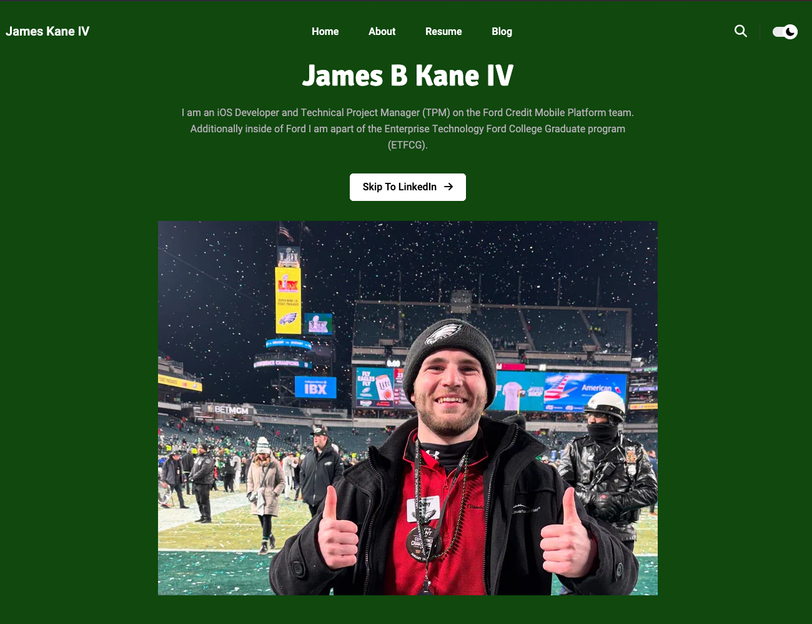
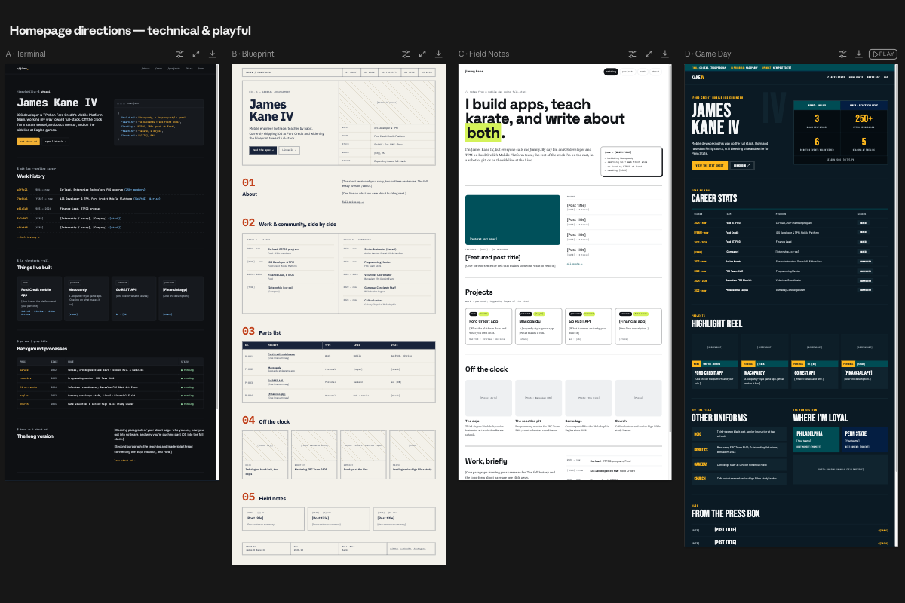

## Why the old site had to go
Flat out, it looked terrible!  I tried some custom theming to make the template I used look like something I could be proud of by changing the primary colors to be Kelly Green and white after the Eagles.  It did not look professional at all nor was content arranged in a way that I could be happy with.  Additionally, since I used a pre-built template, there wasn't any easy way to re-write or reconstruct sections in a way I liked rather than completely redoing it.

## What I wanted instead
I wanted a site that expressed who I am, an avid Eagles and Penn State fan (even if conveniently both teams suck this year)!  I wanted a site that expressed all the details I wanted about me and did so in a creative way different than other templates out there.

In wanting to keep with the football theme, the titles, colors, and format of the site are arranged after football plays and jargon.  Whether it be the "Press Box" (where you are now) or the [404 page](../../404.html), everything matches the football vibe.

## How I worked with Claude
Since my primary specialty is Swift Development and I am a TERRIBLE designer, I started off by giving claude my current site and asking it to generate different styling ideas in Claude Design.  After some critiquing of this current design, I asked it to create a plan which broke down this site creation into smaller tasks which I would merge one by one.  With the second to last PR, bring where I do a majority of the work and manually put in my information.

## What AI was good at, and what it wasn’t

#### Positive Yardage
Obviously the design part is leagues above anything I could've ever designed or through of.  Is it perfect, no.  It never had to be, it is something I plan to fiddle with over time and improve on.  Next one will be speed of execution, if I had been given the designs by Claude but then had to manually implement by hand, this is easily a months worth of free-time for me to complete and that was not going to happen!  With the 18 sub-tasks given, I got through the first 16 in under and hour.  The longest part is doing what I am right now, writing in my information.

#### Bad plays
It isn't all sun-shine and rainbows though.  Claude did pre-fill a lot of information from my previous site but it did take some liberty and embellishment of my true accomplishments.  It wasn't wrong per-se but it would leave a reader with the wrong impression of my skill set and accomplishments.  I could have told Claude to look at my LinkedIn and resume to better fill in my information but I still would be looking at the content in-depth anyway so this wasn't that big of a deal,

## What I’d tell my past self
Back in 2024, I wish I would have looked into the AI design tools.  Were they anywhere near where they are now, no, however it would have been way better than what I ended up with.  I did have the right head space, eventually it was going to get redone, problem is I just kept kicking the can down the road in doing a proper rewrite.